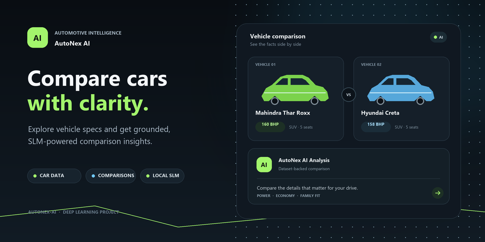
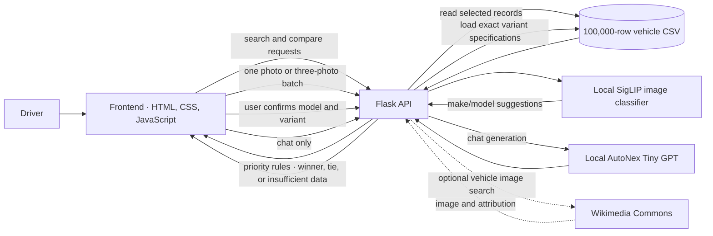
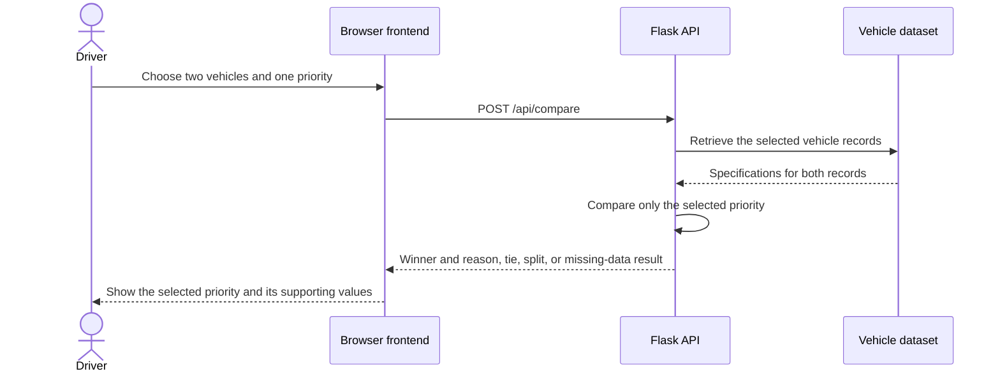
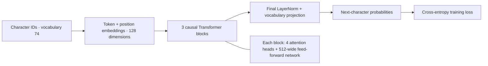

<p align="center">
  
</p>

<h1 align="center">AutoNex AI</h1>

<p align="center">
  <strong>Compare cars with clarity.</strong><br>
  Explore vehicle specifications and compare cars with clear, dataset-grounded results. A compact local GPT model is available for chat.
</p>

<p align="center">
  <a href="https://www.python.org/"></a>
  <a href="frontend/"></a>
  <a href="backend/slm.py"></a>
  <a href="https://github.com/MD123KHAN/DL-Project-"></a>
</p>

---

## What you can do

- 🔎 Search vehicle records by make, model, variant, or year.
- 📋 Review vehicle specifications from the included dataset.
- ⚖️ Compare two vehicles for one selected priority: family capacity, city or highway mileage, off-road drivetrain, running costs, or engine power.
- 🏆 See a clear winner when the selected dataset values support one; ties, conflicting results, and missing data are called out instead of guessed.
- 🧠 Chat with AutoNex Tiny GPT locally; vehicle comparison decisions use deterministic rules over the selected dataset records.
- 🖼️ Upload one car photo for a local make/model suggestion, or recognize three photos together before comparing dataset specifications.
- 🖼️ Look up vehicle images and attribution from Wikimedia Commons when available.
- 💬 Send a prompt directly to the trained SLM through the chat API.

<details>
<summary><strong>📚 Contents</strong></summary>

- [Run it locally](#run-it-locally)
- [Deploy to Render](#deploy-to-render)
- [How it works](#how-it-works)
- [Small language model (SLM)](#small-language-model-slm)
- [API quick reference](#api-quick-reference)
- [Project layout](#project-layout)
- [Data and model files](#data-and-model-files)
- [Troubleshooting](#troubleshooting)
- [Social preview template](#social-preview-template)

</details>

## Run it locally

<details open>
<summary><strong>1. Install Python dependencies</strong></summary>

Create and activate a virtual environment from the repository root, then install the pinned backend packages:

```powershell
python -m venv .venv
.\.venv\Scripts\Activate.ps1
python -m pip install --upgrade pip
python -m pip install -r requirements.txt
```

On macOS or Linux, activate the environment with:

```bash
source .venv/bin/activate
```

</details>

<details open>
<summary><strong>2. Start the backend</strong></summary>

In a terminal at the repository root, start Flask with the project's virtual-environment Python:

```powershell
.\.venv\Scripts\python.exe backend\app.py
```

The Flask API starts at [`http://127.0.0.1:5000`](http://127.0.0.1:5000). It loads the vehicle dataset and attempts to load the SLM checkpoint on startup.

</details>

<details open>
<summary><strong>3. Serve the frontend</strong></summary>

Open a second terminal at the repository root and serve the static UI:

```powershell
python -m http.server 5500 --directory frontend
```

Then open [`http://127.0.0.1:5500`](http://127.0.0.1:5500) in your browser. Keep both terminals running while using the app.

</details>

> **Tip:** The frontend currently points to the local API at `http://127.0.0.1:5000`. The SLM runs locally through PyTorch; comparison and vehicle search do not require a hosted LLM API key.

The image-matching model is separate from the text SLM. Its weights are loaded when the first photo is selected from the open-source [Google SigLIP model](https://huggingface.co/google/siglip-base-patch16-224); this downloads about 813 MB into the local Hugging Face cache. Three uploaded photos are classified in one batch. Images are downscaled to 1024 px before inference, processed in memory, and not saved or sent to an inference API. Set `AUTONEX_VISION_MODEL` to a local model directory to use cached/local weights. Image scores are suggestions, not calibrated certainty; confirm the make/model and dataset variant before comparing.

## Deploy to Render

AutoNex runs as one Render Web Service: Flask serves both the frontend and API from the same URL.

1. In Render, choose **New → Web Service** and connect `MD123KHAN/DL-Project-` on the `main` branch.
2. Use these settings:

   | Render field | Value |
   | --- | --- |
   | Name | `autonex-ai` (or another available name) |
   | Language | `Python 3` |
   | Branch | `main` |
   | Region | `Oregon (US West)` or the region you prefer |
   | Root Directory | Leave blank |
   | Build Command | `pip install -r requirements.txt` |
   | Start Command | `gunicorn --chdir backend app:app --bind 0.0.0.0:$PORT --workers 1 --threads 2 --timeout 180` |

3. Keep the default `AUTONEX_VISION_ENABLED` setting off for a small/free Render instance; the app detects Render and disables image recognition unless you explicitly enable it. Enable it only on an instance with enough disk and memory for the approximately 813 MB SigLIP weights and CPU inference. The repository's `.python-version` selects Python 3.13, and `requirements.txt` installs the CPU-only PyTorch wheel plus Transformers, SentencePiece, Protobuf, and Pillow.
4. When the deploy finishes, open the `onrender.com` URL. Check `https://YOUR-SERVICE.onrender.com/api/health` to confirm the dataset loaded.

The free instance shown in Render is suitable for a first deployment, though loading PyTorch and generating SLM chat replies may be slow or exceed its available memory. If logs show the process being killed or an out-of-memory error, use a larger instance or deploy without loading the SLM.

## How it works



The browser calls the Flask API for vehicle search and comparison. The backend reads selected records from the vehicle CSV and applies deterministic rules. For a two-car comparison, the user chooses one priority and the API returns only that priority's result: a winner with supporting values, a tie, a split result, or a clear explanation when data is insufficient. The frontend shows that focused result alongside the selected vehicles' specification cards. It does not use the language model to decide the winner.

Photo recognition is a suggestion step, not a specification lookup. The local SigLIP classifier proposes a make/model from one uploaded image or a three-image batch. After the user confirms a suggested model and dataset variant, the API loads specifications from the CSV. SigLIP does not infer a vehicle's year, trim, price, or mechanical specifications.

AutoNex Tiny GPT is used for the separate chat feature. Vehicle search, comparison, and image matching use their own data-backed paths and do not wait for GPT text generation.

### Comparison request flow



## Small language model (SLM)

AutoNex includes a small, decoder-only GPT trained from scratch in PyTorch for direct text chat. Vehicle comparison facts are calculated from the selected CSV records with deterministic rules, so generated language cannot change specifications or invent the winning vehicle. The app uses no external LLM API.

### Architecture



Each block uses causal self-attention, a feed-forward network with a width of four times the embedding size, residual connections, LayerNorm, and dropout. Tiny GPT's context window is 768 characters. The output layer predicts one of the 74 characters in the training vocabulary.

### Checked-in model and data audit

The vehicle CSV contains 100,000 structured records; this does not mean there are 100,000 language examples. The checked-in comparison split CSVs currently contain **28,508 train, 3,946 validation, and 3,546 test rows** (36,000 total). These counts differ from the older figures previously recorded here (36,600 / 4,578 / 4,578, or 45,756 total).

The three checked-in splits have no exact vehicle-pair overlap, but they share 123–124 make/model labels across splits. They are therefore not a strict unseen-model evaluation. The Colab notebook below creates new examples by assigning normalized make/model groups to train, validation, and test before constructing pairs. The old CSV splits are preserved for reference and are not used by that notebook.

The active checkpoint has a character vocabulary of 74, context length 768, embedding width 128, 4 heads, and 3 decoder blocks. It has **711,242 trainable parameters**. Its 31,192,687-byte file also contains twelve saved 768 × 768 causal-mask buffers; those buffers explain the larger checkpoint size and are not trainable model parameters.

The original project did not contain a notebook that reproduces the older split files and reported metrics. Those earlier training loss and perplexity values are historical claims, not a verified evaluation of the current split files. The new notebook below creates separate strict grouped splits and fresh train, validation, and test metrics.

### Colab comparison notebook

Open [`notebooks/AutoNex_700K_vs_500M_Colab.ipynb`](notebooks/AutoNex_700K_vs_500M_Colab.ipynb) in Google Colab. It validates the uploaded/Drive CSV, reports the actual number of comparison examples, uses model-grouped splits and one shared character tokenizer, then trains the approximately 700K model from scratch. The approximately 500M model is a separate optional run: the notebook checks active hardware, estimates memory, performs a short smoke test only when the memory gate passes, and leaves full training off by default. It records actual trainable counts, train/validation/test loss and perplexity, time, character tokens per second, peak GPU memory when available, and checkpoint size.

Because the targets are generated from structured fields, the notebook also flags unsupported numeric strings in generated test summaries and prints examples for human review. Loss, perplexity, and that numeric screen do not prove factuality or readability; no conventional accuracy score is reported.

### How to read these metrics

- **Accuracy:** not reported. This is a next-character language model, not a classification model, so the notebook does not calculate a conventional accuracy score.
- **Loss:** cross-entropy measures how well the model predicts the next character in its training-style text. Lower is better for that prediction task, but it does not verify that a comparison is factually correct.
- **Perplexity:** the exponential of cross-entropy loss; it summarizes next-character prediction uncertainty. It is not a factuality or user-rating score.
- **Summary quality:** inspect generated held-out examples for unsupported claims and readability. The notebook's numeric screen is only a warning aid. The app's comparison UI uses deterministic dataset rules instead of free-form model output.

## API quick reference

The Flask API is available at `http://127.0.0.1:5000`.

<details>
<summary><strong>Check service and model status</strong></summary>

```http
GET /api/health
```

Returns dataset readiness, row count, and whether the SLM loaded.

</details>

<details>
<summary><strong>Search for a vehicle</strong></summary>

```http
GET /api/car?q=Mahindra%20Thar
```

Example with `curl`:

```bash
curl "http://127.0.0.1:5000/api/car?q=Mahindra%20Thar"
```

</details>

<details>
<summary><strong>Get dataset-backed vehicle suggestions</strong></summary>

```http
GET /api/suggestions?q=Mahindra%20Thar&limit=10
```

Returns make/model/variant/year suggestions from the vehicle CSV for the main search and comparison selectors.

</details>

<details>
<summary><strong>Suggest a vehicle from an uploaded photo</strong></summary>

```http
POST /api/recognize
Content-Type: multipart/form-data
```

Send the image file in the `image` field. Accepted formats are JPEG, PNG, and WebP; the limit is 8 MB and 20 megapixels. The endpoint returns candidate make/model labels, category suggestions, relative scores, and an uncertainty flag. It does not return specifications. The user confirms or corrects a match, then the app retrieves the selected record from the dataset. The image is processed in memory and is not saved.

Image recognition is disabled by default on Render and returns `503` when disabled or when the local model cannot load. Set `AUTONEX_VISION_ENABLED=true` only on a service with enough resources. `AUTONEX_VISION_MODEL` can select a local model directory or another compatible zero-shot image-classification model.

For three photos, send the image files together to `POST /api/recognize/batch`. The batch route uses one loaded classifier and returns one make/model suggestion per image. Confirm each suggestion and select its dataset variant before comparing specifications.

</details>

<details>
<summary><strong>Compare two vehicles</strong></summary>

```http
POST /api/compare
Content-Type: application/json
```

```json
{
  "car1": "Mahindra Thar Roxx MX3",
  "car2": "Hyundai Creta SX(O)",
  "priority": "family"
}
```

Supported priorities: `family`, `city`, `highway`, `offroad`, `economy`, and `performance`.

The response includes one `priority_result` with its label, verdict, headline, explanation, and the relevant value for each vehicle. `winner` is populated only when the selected records support a winner. A tie, split result, incomparable fields, or missing data is returned without inventing an overall winner. The compatibility field `comparison_basis` also contains only this selected result.

</details>

<details>
<summary><strong>Chat with the SLM</strong></summary>

```http
POST /api/chat
Content-Type: application/json
```

```json
{
  "message": "What should I compare before buying an SUV?"
}
```

This endpoint returns `503` if the checkpoint did not load. Tiny GPT is used for chat; comparison results are generated from dataset values and deterministic rules.

</details>

<details>
<summary><strong>Find a vehicle image</strong></summary>

```http
GET /api/car-image?q=Mahindra%20Thar
```

Image results include a source page and license information when available. Review the original Commons page before reusing an image.

</details>

## Project layout

```text
.
├── backend/
│   ├── app.py                         # Flask API and comparison logic
│   ├── model.py                       # Dataset loading and vehicle search
│   ├── slm.py                         # Tiny GPT architecture and inference
│   └── model_files/                   # Vehicle data, SLM checkpoint, vocab, splits
├── notebooks/
│   └── AutoNex_700K_vs_500M_Colab.ipynb # Colab model comparison workflow
├── frontend/
│   ├── index.html                     # App interface
│   ├── script.js                      # UI behavior and API calls
│   └── style.css                      # Responsive dark theme
├── .python-version                    # Python version used by Render
├── requirements.txt                   # Flask, pandas, PyTorch, Transformers, tokenizer dependencies
├── social-preview.png                 # GitHub-ready social preview
└── README.md
```

## Data and model files

The application expects its data and checkpoint under `backend/model_files/`:

- `cars_dataset_100000_india_global.csv` — vehicle search and specification data.
- `autonex_tiny_gpt_checkpoint.pt` — current Tiny GPT checkpoint.
- `autonex_char_vocab.json` — character vocabulary used by the checkpoint.
- `slm_splits/` — training, validation, and test comparison examples.
- `autonex_slm_comparison_dataset.csv` — comparison training data.
- `AUTONEX_SLM_CHECKPOINT` — optional environment variable to select a separately saved compatible small-model checkpoint. The default checkpoint is preserved.

The repository also contains older checkpoint and vocabulary files for reference. The model runs on CPU by default.

## Troubleshooting

<details>
<summary><strong>The page says it cannot connect to AutoNex</strong></summary>

Make sure the Flask server is still running at `127.0.0.1:5000`, and that the frontend is opened from the local server at port `5500`.

</details>

<details>
<summary><strong>The vehicle dataset could not be loaded</strong></summary>

Confirm that `backend/model_files/cars_dataset_100000_india_global.csv` exists. Start the API from `backend/` with `python app.py` so the expected project paths are available.

</details>

<details>
<summary><strong>The SLM chat is unavailable</strong></summary>

Confirm that `backend/model_files/autonex_tiny_gpt_checkpoint.pt` and `backend/model_files/autonex_char_vocab.json` are present. Check the backend terminal for the model loading or generation error. Vehicle search and priority comparisons use dataset-backed logic and do not depend on the SLM chat model.

</details>

## Social preview template

Use the ready-to-upload [2:1 PNG](social-preview.png) as the repository's social preview; it shows the supplied Mahindra Thar Roxx and Hyundai Creta photos.

---

<div align="center">

Built for automotive exploration · AutoNex AI

</div>
