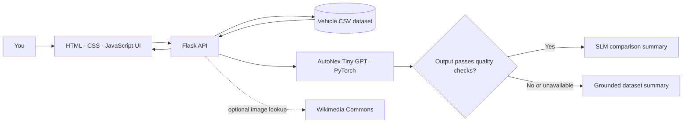

<p align="center">
  
</p>

<h1 align="center">AutoNex AI</h1>

<p align="center">
  <strong>Compare cars with clarity.</strong><br>
  Explore vehicle specifications and compare cars with concise, dataset-grounded summaries powered by a compact, locally loaded GPT model.
</p>

<p align="center">
  <a href="https://www.python.org/"></a>
  <a href="frontend/"></a>
  <a href="backend/slm.py"></a>
  <a href="https://github.com/MD123KHAN/DL-Project-"></a>
</p>

---

## What you can do

- 🔎 Search vehicle records by make, model, variant, or year.
- 📋 Review vehicle specifications from the included dataset.
- ⚖️ Compare two vehicles across family use, city driving, highway trips, off-road driving, fuel economy, or performance.
- 🧠 Generate comparison text with AutoNex Tiny GPT; a grounded dataset summary is used when model output is unavailable or does not pass quality checks.
- 🖼️ Look up vehicle images and attribution from Wikimedia Commons when available.
- 💬 Send a prompt directly to the trained SLM through the chat API.

<details>
<summary><strong>📚 Contents</strong></summary>

- [Run it locally](#run-it-locally)
- [Deploy to Render](#deploy-to-render)
- [How it works](#how-it-works)
- [API quick reference](#api-quick-reference)
- [Project layout](#project-layout)
- [Data and model files](#data-and-model-files)
- [Troubleshooting](#troubleshooting)
- [Social preview template](#social-preview-template)

</details>

## Run it locally

<details open>
<summary><strong>1. Install Python dependencies</strong></summary>

Create and activate a virtual environment from the repository root, then install the backend packages:

```powershell
python -m venv .venv
.\.venv\Scripts\Activate.ps1
python -m pip install --upgrade pip
python -m pip install Flask Flask-Cors pandas torch
```

On macOS or Linux, activate the environment with:

```bash
source .venv/bin/activate
```

</details>

<details open>
<summary><strong>2. Start the backend</strong></summary>

In a terminal at the repository root:

```powershell
cd backend
python app.py
```

The Flask API starts at [`http://127.0.0.1:5000`](http://127.0.0.1:5000). It loads the vehicle dataset and attempts to load the SLM checkpoint on startup.

</details>

<details open>
<summary><strong>3. Serve the frontend</strong></summary>

Open a second terminal at the repository root and serve the static UI:

```powershell
python -m http.server 5500 --directory frontend
```

Then open [`http://127.0.0.1:5500`](http://127.0.0.1:5500) in your browser. Keep both terminals running while using the app.

</details>

> **Tip:** The frontend currently points to the local API at `http://127.0.0.1:5000`. The SLM runs locally through PyTorch; comparison and vehicle search do not require a hosted LLM API key.

## Deploy to Render

AutoNex runs as one Render Web Service: Flask serves both the frontend and API from the same URL.

1. In Render, choose **New → Web Service** and connect `MD123KHAN/DL-Project-` on the `main` branch.
2. Use these settings:

   | Render field | Value |
   | --- | --- |
   | Name | `autonex-ai` (or another available name) |
   | Language | `Python 3` |
   | Branch | `main` |
   | Region | `Oregon (US West)` or the region you prefer |
   | Root Directory | Leave blank |
   | Build Command | `pip install -r requirements.txt` |
   | Start Command | `gunicorn --chdir backend app:app --bind 0.0.0.0:$PORT --workers 1 --threads 2 --timeout 180` |

3. Leave Environment Variables empty, then click **Deploy Web Service**. The repository's `.python-version` selects Python 3.13.
4. When the deploy finishes, open the `onrender.com` URL. Check `https://YOUR-SERVICE.onrender.com/api/health` to confirm the dataset loaded.

The free instance shown in Render is suitable for a first deployment, though loading PyTorch and generating SLM summaries may be slow or exceed its available memory. If logs show the process being killed or an out-of-memory error, use a larger instance or deploy without loading the SLM.

## How it works



Vehicle searches use the included CSV records. For comparisons, the backend formats the selected vehicles and priority for the character-level Tiny GPT model, then uses its response only when it passes basic checks. Otherwise, it builds a short summary from the listed dataset fields.

## API quick reference

The Flask API is available at `http://127.0.0.1:5000`.

<details>
<summary><strong>Check service and model status</strong></summary>

```http
GET /api/health
```

Returns dataset readiness, row count, and whether the SLM loaded.

</details>

<details>
<summary><strong>Search for a vehicle</strong></summary>

```http
GET /api/car?q=Mahindra%20Thar
```

Example with `curl`:

```bash
curl "http://127.0.0.1:5000/api/car?q=Mahindra%20Thar"
```

</details>

<details>
<summary><strong>Compare two vehicles</strong></summary>

```http
POST /api/compare
Content-Type: application/json
```

```json
{
  "car1": "Mahindra Thar Roxx MX3",
  "car2": "Hyundai Creta SX(O)",
  "priority": "family"
}
```

Supported priorities: `family`, `city`, `highway`, `offroad`, `economy`, and `performance`.

</details>

<details>
<summary><strong>Chat with the SLM</strong></summary>

```http
POST /api/chat
Content-Type: application/json
```

```json
{
  "message": "What should I compare before buying an SUV?"
}
```

This endpoint returns `503` if the checkpoint did not load.

</details>

<details>
<summary><strong>Find a vehicle image</strong></summary>

```http
GET /api/car-image?q=Mahindra%20Thar
```

Image results include a source page and license information when available. Review the original Commons page before reusing an image.

</details>

## Project layout

```text
.
├── backend/
│   ├── app.py                         # Flask API and comparison logic
│   ├── model.py                       # Dataset loading and vehicle search
│   ├── slm.py                         # Tiny GPT architecture and inference
│   └── model_files/                   # Vehicle data, SLM checkpoint, vocab, splits
├── frontend/
│   ├── index.html                     # App interface
│   ├── script.js                      # UI behavior and API calls
│   └── style.css                      # Responsive dark theme
├── .python-version                    # Python version used by Render
├── requirements.txt                   # Flask, pandas, PyTorch, Gunicorn
├── social-preview.png                 # GitHub-ready social preview
├── social-preview.svg                 # Editable vector alternative
└── README.md
```

## Data and model files

The application expects its data and checkpoint under `backend/model_files/`:

- `cars_dataset_100000_india_global.csv` — vehicle search and specification data.
- `autonex_tiny_gpt_checkpoint.pt` — current Tiny GPT checkpoint.
- `autonex_char_vocab.json` — character vocabulary used by the checkpoint.
- `slm_splits/` — training, validation, and test comparison examples.
- `autonex_slm_comparison_dataset.csv` — comparison training data.

The repository also contains older checkpoint and vocabulary files for reference. The model runs on CPU by default.

## Troubleshooting

<details>
<summary><strong>The page says it cannot connect to AutoNex</strong></summary>

Make sure the Flask server is still running at `127.0.0.1:5000`, and that the frontend is opened from the local server at port `5500`.

</details>

<details>
<summary><strong>The vehicle dataset could not be loaded</strong></summary>

Confirm that `backend/model_files/cars_dataset_100000_india_global.csv` exists. Start the API from `backend/` with `python app.py` so the expected project paths are available.

</details>

<details>
<summary><strong>The SLM is unavailable or its summary falls back</strong></summary>

Confirm that `backend/model_files/autonex_tiny_gpt_checkpoint.pt` and `backend/model_files/autonex_char_vocab.json` are present. Check the backend terminal for the model loading or generation error. Vehicle search and comparisons can still use the dataset summary when the SLM is unavailable.

</details>

## Social preview template

Use the ready-to-upload [2:1 PNG](social-preview.png) as the repository's social preview; it shows the supplied Mahindra Thar Roxx and Hyundai Creta photos. The [editable SVG](social-preview.svg) is a separate vector alternative and uses simplified car illustrations.

---

<div align="center">

Built for automotive exploration · AutoNex AI

</div>
